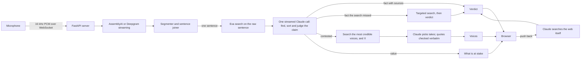

# Common Ground

Common Ground listens to a conversation, talk or broadcast through one microphone and puts what is said in context as it happens. Settled facts are checked against sources. Questions that informed people genuinely disagree on are never scored; instead, the app shows how credible people see them, in their own words. Values are left to the listener.

| Lane | What it covers | What the app shows |
|---|---|---|
| **Fact** | Settled and checkable: dates, numbers, records, who holds an office | A verdict (True, False or Unverified), what is actually the case when the claim isn't true, and the sources |
| **Contested** | How the world is, where informed people disagree ("LLMs can't really reason") | No verdict. Up to two credible voices, each with their stance, a one-line summary, their exact words and the page they come from |
| **Value** | What should be done ("we should spend more on space than on defense") | No verdict and no voices: what is at stake, left to the listener |

**Design principle.** AI is good at finding and synthesizing information; it should not decide what people value. The app checks what can be checked, shows the strongest views on what can't, and leaves judgment to the people in the room.

## Contents

- [Status](#status)
- [Getting started](#getting-started)
- [Using the app](#using-the-app)
- [Deployment](#deployment)
- [How it works](#how-it-works)
- [Trust rules](#trust-rules)
- [Speaker identification](#speaker-identification)
- [Design decisions](#design-decisions)
- [Testing and benchmarks](#testing-and-benchmarks)
- [Project structure](#project-structure)
- [Contributing](#contributing)
- [Known limitations](#known-limitations)
- [Roadmap](#roadmap)

## Status

- **Runs end to end.** The team has run it live on a laptop with Claude, Exa and AssemblyAI.
- **Not yet measured.** The benchmark has not been run, so there are no latency or accuracy figures. The page does not display timings; the benchmark is where they are measured.
- **Tested:**
  - Python unit tests cover the segmenter, sentence joining, the streaming JSON reader, the receipts rule, the verbatim-quote check, deduplication of claims and voices, speaker naming, push-back and the model fallbacks.
  - Wire tests run the real `anthropic` 2.3.0 SDK against a mocked HTTP transport to check request headers, bodies and streamed-event parsing. The Exa, AssemblyAI and Deepgram request formats are checked against their official API references.
  - A browser test drives the real page against a test server that answers from fixed, hand-written data, labeled as test data on screen. The app itself never serves that data.
  - The microphone path, from browser audio to speech-to-text, has no automated test.

## Getting started

### Requirements

- Python 3.12 or newer
- API keys:

| Variable | Service | Needed for |
|---|---|---|
| `ANTHROPIC_API_KEY` | Claude | Required |
| `EXA_API_KEY` | Exa search | Sources and voices. Without it, facts fall back to Claude's own web search (slower) and contested claims get no voices |
| `ASSEMBLYAI_API_KEY` or `DEEPGRAM_API_KEY` | Speech-to-text | Required to listen. AssemblyAI is used when both are set, unless `STT_PROVIDER=deepgram` |

### Install

```bash
python3 -m venv .venv && .venv/bin/pip install -r requirements.txt
```

```bash
cp .env.example .env
```

Add the keys to `.env`: `ANTHROPIC_API_KEY` on line 2, `EXA_API_KEY` on line 6, `ASSEMBLYAI_API_KEY` on line 10 and `DEEPGRAM_API_KEY` on line 11. The file is git-ignored. On startup the server logs a warning for each key that is missing and what it disables.

### Run

```bash
.venv/bin/uvicorn server.app:app --port 8000
```

Open http://localhost:8000 and press **Start**.

Browsers only allow the microphone on `localhost` or over HTTPS. To use a phone, open the app through a tunnel and use the HTTPS link it prints:

```bash
cloudflared tunnel --url http://localhost:8000
```

## Using the app

- **Start** (top right) listens through the microphone. One device covers the whole room, and voices are told apart by diarization. The button turns red with a pulsing dot while recording.
- **Transcript** (left panel) shows everything said, by speaker. It stays on the latest words unless you scroll up. Claims are highlighted with a soft tint in the color of their verdict; clicking a highlight jumps to its card.
- **Context** (right panel) shows one card per claim, newest first, with a running tally of facts checked, false, unverified, contested and values, each in the color of its card label.
  - Each card leads with the exact words that were said.
  - A fact shows its verdict and, when it isn't true, one line on what is. Its sources appear inline as one chip (`en.wikipedia +1`); hovering the chip shows each page's title, date, excerpt and site logo.
  - A contested claim lists its voices as rows: name, stance (agrees, disagrees or complicates), a one-line summary and the source. Clicking a row opens it to the person's exact quote and the page it comes from.
  - A value shows what is at stake.
- **Push back** asks for a deeper re-check that takes your argument into account; the card says whether the verdict changed and why. **Dismiss** removes a card, its highlight, and its place in the tally and recap.
- **Clear** (on the transcript panel) starts over with an empty page and a fresh server session, so nothing from the previous conversation carries over.
- **Speaker names.** The app suggests names for "Speaker A", "Speaker B" from explicit cues in the conversation; confirm with one click, or click a name to set it.
- **Keyboard.** `S` opens the recap: the facts checked (false first), the open questions with who stands where, and the values. `P` toggles presentation mode. `Esc` closes the recap.

## Deployment

`render.yaml` is a [Render Blueprint](https://dashboard.render.com/blueprints) for a single web service:

- `uvicorn server.app:app --host 0.0.0.0 --port $PORT --workers 1`, with `/api/config` as the health check.
- One instance and one worker: a listening session lives in one process, and a second instance would split it.
- A plan that stays running. Render's free plan sleeps, which drops an open listening session.
- The four API keys are declared with `sync: false`, so they are set in the Render dashboard and never stored in the repository.

Render serves the app over HTTPS, so the microphone works on phones without a tunnel. `.python-version` pins Python 3.12.

## How it works



### Components

1. **Browser** (`web/`, no build step). An AudioWorklet turns microphone audio into 16 kHz mono PCM and streams it over one WebSocket. Events come back on the same socket and are drawn as they arrive: lines, claims, verdicts and voices.
2. **Speech-to-text** (`server/stt.py`). The server relays audio to AssemblyAI Universal-3.6 Pro (`speaker_labels=true`) or Deepgram Nova-3 (`diarize_model=latest`) and receives words with speaker labels.
3. **Segmentation** (`server/segmenter.py`). Decides when a statement is complete enough to check (see below).
4. **Session** (`server/session.py`). For each statement: shows the line, runs the check, escalates facts the first search didn't cover, and fetches voices for contested claims. It also runs push-back, deduplicates claims and voices, and suggests speaker names.
5. **Claude layer** (`server/llm.py`, `prompts.py`, `schemas.py`). Every call uses JSON-schema outputs. Push-back uses Claude's web search tool with a strict `submit_verdict` tool for the answer.
6. **Search** (`server/search.py`, `backends.py`). Exa `lite`, Exa's search type for real-time and voice use:
   - **Facts:** 10 results per search, with an `objective` that asks Exa to rank primary and authoritative sources first (official pages, data, research, reference works, established news). A verdict cites its best source; a false or misleading one may add a second from another site. `MAX_SOURCES` (default 2) and one reference per site are enforced in code.
   - **Contested claims:** no one picks voices by hand. When Claude sorts a claim, it names up to three of the most credible people on that exact question who have publicly argued a different view. The search looks for them and for the discussion on X itself. X feeds this lane only, never verdicts: a post saying something does not make it true. `MAX_TAKES` (default 2) caps the voices shown, one per person.
   - Requests send only fields that `lite` accepts, and the server logs any `warnings` Exa returns about ignored fields.

### When a statement is checked

Interim transcripts are never checked; they only drive the live caption. Finished words collect into the current speaker's statement, which is sent when:

1. another speaker starts talking;
2. a sentence ends (`.` `?` `!`) and the statement has at least 3 words (abbreviations such as "U.S." don't count);
3. 35 words pass without a sentence end;
4. the speaker pauses (Deepgram: 300 ms) and the statement has at least 6 words; or
5. the utterance ends (Deepgram: 1 s without words).

The unit is the sentence: a claim rarely spans two, and waiting for whole turns would delay every card until the speaker stops. The previous six lines are sent as context, so "He was the 45th too" still resolves.

AssemblyAI streams turns rather than segments, so `TurnSegmenter` splits each finished turn into sentences and cuts long turns at 35 words. With speaker labels, AssemblyAI ends a turn after 768 ms of silence whether or not the sentence is finished, so `SentenceJoiner` holds an unfinished statement in the caption and joins it to what the same speaker says next. It is sent as is when someone else speaks, after 2 s of silence, or when listening stops.

### Latency design (unmeasured)

1. **One Claude call per sentence**, not two: finding, sorting and judging share one round trip.
2. **Search starts first,** on the raw sentence, the moment the sentence is complete.
3. **Streaming JSON** (`server/jsonstream.py`): a claim is highlighted as soon as its quote has streamed in, and gets its verdict when its JSON object closes.
4. **Low effort** on the live path, with explanations capped at 20 words.
5. **Warm-up at startup** pays the one-time schema compilation cost Anthropic documents and opens connections before the first sentence.
6. **Hard cases don't block:** when the first search misses a fact, Claude's first read is shown as unconfirmed while a targeted search runs.
7. **Fast mode** is used automatically if a role runs on Opus 5, 5.5 or 4.8, the only models that offer it. The default live model, Sonnet 5.5, does not.

## Trust rules

- **No receipts, no red.** A True, False or misleading verdict must cite a page the search actually returned. Otherwise it is shown as Unverified, with the direction it was leaning.
- **A wrong red flag is worse than a missed one.** The prompts say so, and the benchmark counts false alarms separately.
- **Flag rarely.** A card has to earn its place: something that looks false or misleading, a specific public claim the conversation relies on, or a real public dispute. Common knowledge, private facts, tastes, plans, insults and jokes get nothing.
- **One sentence, one card.** A claim's quote must come from the sentence being checked, and the same claim never gets a second card. This is enforced in code as well as in the prompts.
- **Unverified on screen covers two cases:** the evidence doesn't settle the claim, or the claim is technically true but misleading. The model keeps the two apart internally so a misleading claim's correction is still shown.
- **Values are the listener's.** They get what is at stake, with no voices and no citations: there is no fact to settle, and who agrees doesn't change that.
- **Quotes are verbatim or dropped.** Every quote from a voice is checked in code against the text of its page.
- **Contested is not false.** A voice's stance tag takes the color of its card's label (blue for contested), never the red or green of a verdict. The word and symbol say where each person stands: ⇄ disagrees, ≈ complicates, = agrees.
- **People have the last word.** Anyone can push back on a verdict and get a deeper re-check, or dismiss a card.
- **Dates matter.** Today's date is in every prompt, because claims about the present depend on it.

## Speaker identification

Video-call tools receive each participant on a separate channel. One microphone in a room records one mixed stream, and separating it is *speaker diarization*: grouping voices into "Speaker A, B, C". How well that works in this app has not been measured. Published results:

- **Streaming diarization on DIHARD III** (hard, real-world audio), in a [benchmark published by pyannoteAI](https://www.pyannote.ai/blog/streaming-diarization-benchmark) on 2026-10-30. pyannoteAI competes with all three vendors.

  | System | Diarization error rate | Of which, wrong speaker |
  |---|---|---|
  | Speechmatics real-time v2 | 31.3% | 5.5% |
  | Deepgram Nova-3 | 39.1% | 9.3% |
  | AssemblyAI Universal Streaming v3 | 39.2% | 11.8% |

  The AssemblyAI model tested may differ from Universal-3.6 Pro, which this app uses.
- **AssemblyAI's documented limits** ([docs](https://www.assemblyai.com/docs/streaming/label-speakers-and-separate-channels)): turns shorter than about 1 s are labeled `PENDING`; overlapping speech goes to one speaker; the first one or two turns may be misassigned; corrected labels arrive at most once every 2 minutes of audio.

Diarization separates voices but cannot name them, so every few lines Claude proposes names from explicit cues, and the cue decides who the name belongs to: "I'm Sam" names the speaker, "Thanks, Yann" usually the previous speaker, "Yann, what do you think?" the next one, and a name of someone outside the conversation names nobody. It never guesses from what someone talks about, its evidence must appear verbatim in the transcript, and a person confirms each suggestion.

When speakers are known in advance, [Speechmatics real-time speaker identification](https://docs.speechmatics.com/speech-to-text/realtime/speaker-identification) can return names live from enrolled voice samples. It is not integrated.

## Design decisions

### Language models

The live path makes one call per sentence and needs the earliest first token. Push-back needs a model that holds its position under pressure. Every role can be changed with `LIVE_MODEL`, `CHECK_EFFORT`, `PUSHBACK_MODEL` and `PUSHBACK_EFFORT`.

Speed and capability as measured by [Artificial Analysis](https://artificialanalysis.ai/leaderboards/models) (retrieved 2026-10-31; medians on each provider's API with Artificial Analysis's prompts, not this app's):

| Model (setting) | First chunk | Output speed | Intelligence Index |
|---|---|---|---|
| GPT-6.1 Terra (non-reasoning) | 0.96 s | 90 tok/s | 30 |
| DeepSeek V4.1 Flash (non-reasoning) | 1.15 s | 1,486 tok/s | 19 |
| Claude Sonnet 5.5 (low) | 1.30 s | 105 tok/s | 25 |
| GPT-6 Astra (low) | 2.02 s | 58 tok/s | 43 |
| Claude Fable 5.1 (low) | 2.27 s | 55 tok/s | 38 |
| Grok 4.7 (low) | 5.74 s | 72 tok/s | 31 |
| Claude Opus 5.5 (low) | 6.16 s | 78 tok/s | 35 |
| Claude Haiku 5.5 (low) | 7.89 s | 158 tok/s | 19 |

For reasoning settings, "first chunk" may be a reasoning token rather than answer text, so the non-reasoning rows compare most cleanly. The Intelligence Index is a general measure, not a claim-checking one.

- **Live path: Claude Sonnet 5.5 at low effort.** Among the earliest first chunks, and integrated with structured outputs and the server-side refusal fallback. GPT-6.1 Terra and DeepSeek V4.1 Flash could be faster; comparing them needs an adapter for their APIs and a benchmark run.
- **Not Opus 5.5 on the live path:** 6.16 s to the first chunk at low effort.
- **Push-back: Claude Sonnet 5.5 at high effort.** On MASK, which tests whether a model contradicts its own beliefs under pressure, the [Opus 5.5 system card](https://www.anthropic.com/claude-opus-5-5-system-card) places Opus 5.5 below Opus 5, Sonnet 5 and Mythos 5 and reports "a modest countervailing increase in susceptibility to user pressure"; the [Haiku 5.5 system card](https://www.anthropic.com/claude-haiku-5-5-system-card) places Sonnet 5.5 above Opus 5.5. The push-back prompt also states that being challenged is not evidence.
- **Recall from memory matters less here.** Opus 5.5 leads Claude models on closed-book factuality (AA-Omniscience 0.58 against Haiku 5.5's 0.12, per the system cards), but verdicts must cite search results.
- **Specialized verifiers** lead [LLM-AggreFact](https://llm-aggrefact.github.io/), which checks a claim against a document (nimble-v4-max 79.5, Bespoke-MiniCheck-7B 77.4, against Claude 3.5 Sonnet 77.2 and GPT-4o 75.9). They only answer supported or not, without finding, sorting or explaining claims, and need GPU hosting.

### Speech-to-text

**AssemblyAI Universal-3.6 Pro by default, Deepgram Nova-3 supported.** Both diarize while streaming. On the independent [Pipecat streaming benchmark](https://github.com/pipecat-ai/stt-benchmark) (1,000 voice-agent turns, September 2026 scoring):

| Model | Mean WER | Perfect transcripts | Median time to final |
|---|---|---|---|
| AssemblyAI universal-3-6-pro | 0.89% | 88.7% | 307 ms |
| Soniox stt-rt-v5 | 1.11% | 83.6% | 260 ms |
| Speechmatics linden-1 | 1.11% | 83.9% | 369 ms |
| Deepgram nova-3-general | 1.32% | 77.7% | 247 ms |
| ElevenLabs scribe_v2_realtime | 3.05% | 80.3% | 281 ms |

Differences under about 0.25 points fall within the benchmark's 95% confidence interval. For a fact-checker a misheard number costs more than 60 ms, so AssemblyAI is the default.

### Search

**Exa `lite`**, introduced on 2026-10-19, when Exa made `fast` and `instant` legacy types. On the independent [Artificial Analysis Search Index](https://artificialanalysis.ai/agents/search-api) (data from 2026-10-19):

| API | Score |
|---|---|
| Perplexity Search (medium) | 80 |
| Exa auto | 80 |
| Exa lite | 79 |
| Perplexity Search (high) | 79 |
| Brave LLM Context | 75 |
| Parallel (advanced) | 75 |
| Parallel (basic) | 73 |

Exa `lite` and Perplexity Search are effectively tied on accuracy. The index reports time per agentic task rather than per query; Exa publishes a p50 under 425 ms for `fast`, which `lite` runs the same search as, and no verified per-query figure for Perplexity was found.

## Testing and benchmarks

### Unit and wire tests

```bash
.venv/bin/python -m pytest
```

### Browser test

Start the test server, which answers from the fixed data in `tests/fixtures.json`:

```bash
.venv/bin/python -m tests.serve 8765
```

Then run the script, which needs Playwright with Chromium (`npm install playwright` and `npx playwright install chromium`):

```bash
node tests/e2e.cjs http://localhost:8765
```

### Benchmark

`bench/claims.jsonl` holds 42 labeled statements: true and false facts, private claims, contested claims, values and statements that should get no card. The runner reports lane and verdict accuracy, false alarms (true statements shown as false), noise (cards that shouldn't exist, split sentences, references per verdict), and p50 and p90 latency for search, first highlight, the Claude call and time to verdict.

```bash
.venv/bin/python -m bench.run_bench --repeat 3
```

To compare settings, change one variable per run:

```bash
CHECK_EFFORT=medium .venv/bin/python -m bench.run_bench --repeat 3
```

```bash
.venv/bin/python -m bench.run_bench --no-search --repeat 3
```

The second uses Claude's own web search instead of Exa. The benchmark starts from text, so speech-to-text time is not included; the speech-to-text settings worth measuring live are AssemblyAI's `max_turn_silence` (`ASSEMBLYAI_MAX_TURN_SILENCE`) and Deepgram's endpointing (300 ms).

## Project structure

| Path | Contents |
|---|---|
| `server/app.py` | HTTP and WebSocket server; one session per connection; startup key checks |
| `server/session.py` | Statements in; claims, verdicts and voices out; push-back; the receipts rule; deduplication; speaker naming |
| `server/segmenter.py` | When a statement is complete enough to check, and sentence joining |
| `server/llm.py`, `prompts.py`, `schemas.py` | Every Claude call, its prompt and its JSON schema |
| `server/jsonstream.py` | Reads claims out of the streaming answer as they complete |
| `server/search.py`, `backends.py` | Exa search and the backend that runs each check |
| `server/stt.py` | AssemblyAI and Deepgram streaming relays |
| `server/config.py` | Settings, read from the environment and `.env` |
| `web/` | The page: `index.html`, `app.js`, `styles.css`, `pcm-worklet.js` |
| `bench/` | Labeled statements and the benchmark runner |
| `tests/` | Python and wire tests, the browser test, its test server (`serve.py`) and fixed test data |
| `render.yaml`, `.python-version` | Render deployment |

## Contributing

- Branch from `main` and open a pull request. Run the Python and browser tests first.
- Never commit a key, and never include one in a screenshot or a pasted log. `.env` is git-ignored.
- Every number in this README is either measured, with the method, or cited, with a link. Anything else is marked as unmeasured.

## Known limitations

- **No measurements yet.** Latency and accuracy are unknown until the benchmark is run.
- **Diarization from one microphone is untested.** Overlapping speech, short interjections and similar voices are the usual failure cases.
- **Long conversations are untested.** Behavior over many minutes of real speech, with many claims, is unknown.
- **X coverage is unknown.** How much of X Exa's index covers is unclear; voices are also searched on the open web.
- **Verdicts depend on what the search finds,** which is why Unverified exists.

## Roadmap

1. **Measure:** run the benchmark across settings (effort, Exa versus Claude search) and time speech-to-text on real audio.
2. **Run long real conversations:** check sentence cuts, which claims get cards, and how the recap reads.
3. **Compare other live models:** an adapter for GPT-6.1 Terra and DeepSeek V4.1 Flash, run through the same benchmark.
4. **Speechmatics with enrolled voices,** for when speakers are known in advance.
5. **Test whether speaker names help:** run voices on the same contested claims with the speaker named and anonymous, and compare the verified quotes found.
6. **Race two search providers:** run Exa and Brave on the first search and use whichever answers first.
