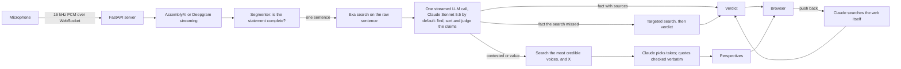

# Common Ground

One device listens to a conversation, talk or broadcast, and works through every statement as it's spoken:

| Lane | What it is | What you see |
|---|---|---|
| **Fact** | Settled and checkable: dates, numbers, records, who holds an office | A small verdict (true, false, missing context, unverified), what's actually so when it isn't true, and the sites checked |
| **Contested** | About how the world is, but informed people disagree ("LLMs can't really reason") | No verdict. How credible people see it, **in their own words**, each quote linked to its page |
| **Value** | What should be done ("we should spend more on space than on defense") | No verdict. The other side's case, and the reminder that this one is yours |

## The idea

The hackathon prompt is that one must remain human, and for us the human core is our values. AI is very good at finding and synthesizing information. It shouldn't decide what you value. So the app splits the job:

- **Facts are checkable.** The app checks them fast and shows the sources.
- **Worldviews aren't.** The app never scores them. It shows the strongest takes from people who see it differently, and you weigh them.

Fact-checking is the easy part. The interesting moment is when you're listening to Yann LeCun say LLMs can't reason, and Andrej Karpathy's own words on that question appear beside it, with the link.

## Status: what is verified and what isn't

- **Runs live, unmeasured.** The team has run it on a laptop with real Claude, Exa and AssemblyAI keys. **Nothing has been measured systematically yet:** no benchmark run, so no latency or accuracy figures. The page doesn't show timings; the benchmark is where they get measured.
- **Request formats.**
  - The Claude calls are checked through the real `anthropic` 2.3.0 SDK against a mocked HTTP transport (`tests/test_wire.py`). That covers headers, body and the parsing of streamed events.
  - The Exa, AssemblyAI and Deepgram formats are checked against their official API references only.
- **Tests.**
  - Python: segmenter rules, streaming JSON reader, receipts rule, verbatim-quote check, speaker naming, push-back, fast-mode fallback.
  - Browser: `tests/e2e.cjs` drives the page against `tests/serve.py`, a test server that answers from the **fixed, hand-written data** in `tests/fixtures.json` and labels it as test data on screen. The app itself never serves that data. The microphone path (browser audio through to speech-to-text) has no automated test.
- **The first thing to do with keys** is measure. See "Measuring speed and accuracy".

## Run it

```bash
python3 -m venv .venv && .venv/bin/pip install -r requirements.txt
```

```bash
cp .env.example .env
```

Fill in the keys in `.env` (git-ignored, so they can't be committed):

- `ANTHROPIC_API_KEY` (line 2): Claude. Required.
- `EXA_API_KEY` (line 6): search, and the takes from other voices. Without it, facts go to Claude's own web search (slower) and the takes are off.
- `ASSEMBLYAI_API_KEY` (line 10), or `DEEPGRAM_API_KEY` (line 11): speech-to-text for the microphone. Required to listen; without one you can only type lines in.

Then start the server:

```bash
.venv/bin/uvicorn server.app:app --port 8000
```

Open http://localhost:8000 and press **Start**. One microphone listens to the whole room, and voices are told apart by diarization (see "Telling voices apart").

On screen:

- **The transcript** is a two-line strip that stays on the latest words; scroll it up to read back.
- **Cards** lead with the exact words that were said. A plain fact gets a small verdict and, when it isn't true, one line on what is, with its sources cited inline as one chip (`en.wikipedia +2`); hovering the chip shows each page's title, excerpt and site logo. Contested claims and values list the other voices, one row each: who, where they stand, a one-line summary and the source. Click a row to open it to the person's exact words and the page they come from.
- **Push back** asks for a deeper re-check; **Dismiss** removes a card, its highlight and its place in the tally.
- **Clear** (on the transcript panel) starts over: an empty page and a fresh session on the server, so nothing from the old conversation carries into the new one.
- **Keys:** S opens the recap ("Common ground": the facts checked, false first; the open questions with who stands where; the values that are yours to weigh). P toggles presentation mode. Esc closes the recap.

**On a phone:** browsers only allow the microphone over HTTPS, so open the app through a tunnel. Then open the https link it prints:

```bash
cloudflared tunnel --url http://localhost:8000
```

## Architecture



The pieces:

1. **Browser (`web/`, no build step).**
   - An AudioWorklet turns the microphone into 16 kHz mono PCM and streams it to the server over one WebSocket.
   - Events come back the same way and are drawn as they arrive: lines, claims, verdicts and perspectives.
2. **Speech-to-text (`server/stt.py`).** The server relays the audio to AssemblyAI Universal-3.6 Pro (`speaker_labels=true`) or Deepgram Nova-3 (`diarize_model=latest`), and gets back words with speaker labels.
3. **Segmenter (`server/segmenter.py`).** Decides when a statement is complete enough to check (rules below).
4. **Session (`server/session.py`).** For each statement it does four things:
   - shows the line;
   - searches Exa with the raw sentence and makes **one** streamed Claude call that finds the claims, sorts them into lanes and judges the facts;
   - escalates facts the first search didn't cover;
   - fetches perspectives for contested claims and values.

   It also handles push-back and suggests names for anonymous speakers.
5. **Claude layer (`server/llm.py`, `prompts.py`, `schemas.py`).** Each role has its own model (see "Model and vendor choices"); all calls use JSON-schema outputs. Push-back uses Claude's own web search tool, with a strict `submit_verdict` tool for the answer.
6. **Search (`server/search.py`).** Exa `lite`, Exa's type for real-time and voice use.
   - Facts: 10 results per search, with an `objective` that tells Exa to rank primary and authoritative sources first (official pages, data, research, reference works, established news). Claude cites every result that backs a verdict, up to 5, most authoritative first.
   - Contested claims and values: nobody picks the voices by hand. When Claude sorts a claim it names up to three of the most credible people on that exact question who have publicly argued a different view, and the search looks for them, plus X itself on the topic, so takes come from people's own posts as well as the open web. X posts feed this lane, not verdicts: a post saying something doesn't make it true.
   - Each request sends only what `lite` accepts, and the server logs any `warnings` Exa returns about ignored fields.

### When does a statement get sent?

Interim transcripts are never checked; they only drive the live caption. Finished words collect into the current speaker's statement, and it is sent as soon as any of these happens:

1. **Another speaker starts talking.**
2. **A sentence ends** (`.` `?` `!`) and the statement has at least 3 words. Abbreviations like "U.S." don't count.
3. **35 words go by without a sentence end.**
4. **The speaker pauses** (Deepgram: 300 ms) and the statement has 6+ words.
5. **The utterance is over** (Deepgram: 1 s without words).

The unit is the sentence because a claim rarely spans two of them, and waiting for a whole turn would hold every claim until the speaker stops. The previous six lines go along as context, so "He was the 45th too" still resolves.

AssemblyAI streams turns instead of segments, so `TurnSegmenter` sends each finished turn sentence by sentence, and cuts long turns at 35 words.

### Latency design, all unmeasured

What each choice is meant to do, and why:

1. **One Claude call per sentence instead of two.** Extraction and judging share a single round trip.
2. **The search starts before Claude.** It runs on the raw sentence the moment the sentence is complete.
3. **Streaming JSON** (`server/jsonstream.py`). Each claim is drawn as soon as its quote has streamed in, and gets its verdict when its JSON object closes, without waiting for the rest of the answer.
4. **Fast mode** is used when a role runs on Opus 5, 5.5 or 4.8, the only models that have it (Anthropic documents up to 2.5× output speed, at a premium price). The live path's default, Sonnet 5.5, doesn't have it.
5. **Effort `low`,** and explanations capped at 20 words.
6. **Warm-up at startup.** Anthropic documents a one-time compile cost for each new JSON schema; the warm-up pays it and opens connections before anyone is watching.
7. **Hard cases don't block.** When the first search missed a fact, Claude's first read is shown as unconfirmed while a targeted search runs.

### Measuring speed and accuracy

`bench/claims.jsonl` holds 37 labeled statements: true and false facts, private claims, contested claims, values, and non-claims. The runner reports:

- whether each statement was sorted into the right lane and given the right verdict;
- **false alarms:** true statements shown as false or misleading;
- p50 and p90 latency for search, first highlight, the Claude call, and time to verdict.

```bash
.venv/bin/python -m bench.run_bench --repeat 3
```

Compare settings by re-running it with one variable changed:

```bash
FAST_MODE=0 .venv/bin/python -m bench.run_bench --repeat 3
```

```bash
CHECK_EFFORT=medium .venv/bin/python -m bench.run_bench --repeat 3
```

```bash
.venv/bin/python -m bench.run_bench --no-search --repeat 3
```

The last one uses Claude's own web search instead of Exa.

The benchmark starts from text, so speech-to-text time is not included. Speech-to-text knobs worth measuring live:

- AssemblyAI's `max_turn_silence`, set with `ASSEMBLYAI_MAX_TURN_SILENCE`. Its documented default with speaker labels is 768 ms on Universal-3.5 Pro.
- Deepgram's `endpointing`, currently 300 ms.

### Trust rules

- **No receipts, no red.** A true, false or misleading verdict must cite a page the search actually returned. Otherwise it shows as unverified, along with which way it was leaning.
- **A wrong red flag is worse than a missed one.** The prompts say so, and the benchmark counts false alarms separately.
- **Quotes are verbatim or dropped.** Every perspective quote is checked in code against the text of its page.
- **Contested isn't false.** Stances are color-coded in hues the verdicts don't use (pink for disagrees, yellow for complicates, gray for agrees), so a disagreeing take never reads as a red "false".
- **Humans get the last word.**
  - Anyone can push back on a verdict. Claude re-checks with a deeper web search and says whether it changed its mind.
  - Anyone can dismiss a card. It leaves the page, the transcript highlight, the tally and the recap.
- **Dates matter.** Today's date is in every prompt, because claims about the present depend on it.

## Telling voices apart with one device

Google Meet and Zoom don't recognize voices. Every participant joins on their own device, so each voice arrives on its own channel. One device in a room records **one mixed stream**, and splitting it is *speaker diarization*: an acoustic model groups voices into "Speaker A, B, C". Nobody has measured how well that works in this app yet. What others have measured:

- **Streaming APIs on DIHARD III (hard, real-world audio).** In a [benchmark run by pyannoteAI](https://www.pyannote.ai/blog/streaming-diarization-benchmark), a competitor of all three vendors, published 2026-10-30:

  | System | Diarization error rate | Of which, wrong speaker |
  |---|---|---|
  | Speechmatics real-time v2 | 31.3% | 5.5% |
  | Deepgram Nova-3 | 39.1% | 9.3% |
  | AssemblyAI Universal Streaming v3 | 39.2% | 11.8% |

  That AssemblyAI model may not be the Universal-3.6 Pro we use.
- **AssemblyAI's own documented limits** ([docs](https://www.assemblyai.com/docs/streaming/label-speakers-and-separate-channels)):
  - Turns shorter than about 1 s are labeled `PENDING`.
  - Overlapping speech goes to one speaker.
  - The first one or two turns may be misassigned.
  - Corrected labels arrive at most once every 2 minutes of audio, so they can't fix a live tally.

Diarization separates voices but can't say whose they are, so the app suggests names:

- Every few lines, Claude proposes names for unnamed speakers from explicit cues, and the cue decides who the name points at:
  - "I'm Sam" names the person speaking.
  - "Thanks, Yann" usually names the previous speaker.
  - "Yann, what do you think?" names the next speaker.
  - A name of someone outside the conversation names nobody.
- It never guesses from what someone talks about, and its evidence must appear verbatim in the transcript.
- A person confirms each suggestion with one click, or clicks a speaker's name to set it by hand.
- Names are passed to Claude with each statement. Whether that improves the perspectives lane is **untested**; see "Next steps".

**Better when the speakers are known in advance:** [Speechmatics real-time speaker identification](https://docs.speechmatics.com/speech-to-text/realtime/speaker-identification) takes enrolled voices, recorded from each person speaking alone, and returns their names live, with unknown voices labeled S1, S2. It isn't integrated yet.

## Model and vendor choices

### Language model, by role

The live path makes one call per sentence and needs the earliest possible first token. Push-back needs a model that holds its position under pressure. No role needs the single most capable model.

Speed and capability as measured by [Artificial Analysis](https://artificialanalysis.ai/leaderboards/models) (fetched 2026-10-31). These are medians on each provider's own API, with Artificial Analysis's prompts, not ours:

| Model (setting) | First chunk | Output speed | Intelligence Index |
|---|---|---|---|
| GPT-6.1 Terra (non-reasoning) | 0.96 s | 90 tok/s | 30 |
| DeepSeek V4.1 Flash (non-reasoning) | 1.15 s | 1,486 tok/s | 19 |
| Claude Sonnet 5.5 (low) | 1.30 s | 105 tok/s | 25 |
| GPT-6 Astra (low) | 2.02 s | 58 tok/s | 43 |
| Claude Fable 5.1 (low) | 2.27 s | 55 tok/s | 38 |
| Grok 4.7 (low) | 5.74 s | 72 tok/s | 31 |
| Claude Opus 5.5 (low) | 6.16 s | 78 tok/s | 35 |
| Claude Haiku 5.5 (low) | 7.89 s | 158 tok/s | 19 |

How to read it:

- **Reasoning rows may flatter themselves.** For reasoning settings, "first chunk" can be a reasoning token rather than the answer, so the non-reasoning rows are the clean comparisons. Our benchmark measures time to the first claim on screen, which is what counts.
- **The Intelligence Index is general** (math, coding, knowledge), not claim checking.

The choices:

- **Live path: Claude Sonnet 5.5 at low effort,** for now.
  - Among the earliest first chunks.
  - Already wired in, with structured outputs and the server-side refusal fallback.
  - The two that could beat it are GPT-6.1 Terra and DeepSeek V4.1 Flash (both non-reasoning). Deciding between them takes our benchmark plus an adapter for their APIs, which isn't built yet.
- **Not Opus 5.5 in the live path.** It takes 6.16 s to its first chunk even at low effort.
- **Push-back: Claude Sonnet 5.5 at high effort.** Push-back is user pressure. On MASK, which measures whether a model contradicts its own belief when pushed:
  - The [Opus 5.5 system card](https://www.anthropic.com/claude-opus-5-5-system-card) places Opus 5.5 below Opus 5, Sonnet 5 and Mythos 5, and reports "a modest countervailing increase in susceptibility to user pressure".
  - The [Haiku 5.5 system card](https://www.anthropic.com/claude-haiku-5-5-system-card) places Haiku 5.5 "approximately tied" with Sonnet 5.5, and above Opus 5.5.
  - The push-back prompt also states that being challenged is not evidence.
- **Facts from memory matter less here.** Opus 5.5 leads Claude models on closed-book factuality (AA-Omniscience net score 0.58, against Haiku 5.5's 0.12, per the system cards). But our verdicts must cite the search results, so memory matters less than speed.
- **Every role can be switched** for comparison: `LIVE_MODEL`, `CHECK_EFFORT`, `PUSHBACK_MODEL`, `PUSHBACK_EFFORT`.

**Specialized verifiers** are strong but not a fit yet. [LLM-AggreFact](https://llm-aggrefact.github.io/), which checks a claim against a document, is led by 7–27B specialized models:

| Model | Score |
|---|---|
| nimble-v4-max | 79.5 |
| Bespoke-MiniCheck-7B | 77.4 |
| Claude 3.5 Sonnet | 77.2 |
| GPT-4o | 75.9 |

No 2026 frontier model appears in that table. These models only answer supported or not: they don't find claims, sort them into lanes, or explain. They also need GPU hosting. Worth revisiting if the benchmark shows the verdicts are the weak point.

### Speech-to-text

**AssemblyAI Universal-3.6 Pro, with Deepgram Nova-3 supported.** Both diarize while streaming, per their API references.

On the independent [Pipecat streaming benchmark](https://github.com/pipecat-ai/stt-benchmark) (1,000 voice-agent turns, September 2026 scoring):

| Model | Mean WER | Perfect transcripts | Median time to final |
|---|---|---|---|
| AssemblyAI universal-3-6-pro | 0.89% | 88.7% | 307 ms |
| Soniox stt-rt-v5 | 1.11% | 83.6% | 260 ms |
| Speechmatics linden-1 | 1.11% | 83.9% | 369 ms |
| Deepgram nova-3-general | 1.32% | 77.7% | 247 ms |
| ElevenLabs scribe_v2_realtime | 3.05% | 80.3% | 281 ms |

- The benchmark notes that differences under about 0.25 points are within its 95% confidence interval.
- For a fact-checker a misheard number costs more than 60 ms, so AssemblyAI is the default. Set `STT_PROVIDER=deepgram` to prefer Deepgram.

### Search

**Exa `lite`** (launched 2026-10-19, replacing `instant` and `fast`). On the independent [Artificial Analysis Search Index](https://artificialanalysis.ai/agents/search-api) (data from 2026-10-19):

| API | Score |
|---|---|
| Perplexity Search (medium) | 80 |
| Exa auto | 80 |
| Exa lite | 79 |
| Perplexity Search (high) | 79 |
| Brave LLM Context | 75 |
| Parallel (advanced) | 75 |
| Parallel (basic) | 73 |

- **Exa lite and Perplexity Search tie on accuracy.** That board reports time per agentic task, not per query. Exa's own published figure for `fast`, which `lite` runs the same search as, is p50 under 425 ms. I found no per-query figure for Perplexity that I could verify.
- **Exa stays.** Racing both on every sentence is a cheap option if Perplexity proves fast in our measurements.
- **Perplexity's Sonar models**, which search and answer in one call, aren't on the Artificial Analysis leaderboard, so there is no data to choose them on.

## A three-minute walkthrough

1. **Facts.** Someone says *"Joe Biden is the 47th president, right?"* (he was the 46th). The card shows those words, False, what's actually so, and its sources.
2. **Push back.** Dispute the verdict and watch the re-check.
3. **Worldviews.** Say *"LLMs can't really reason."* The card fills with how the most credible people on that question see it, in their own words, each quote linked.
4. **Common ground.** Press S for the recap: what was false, which questions stay open and who stands where, and the values the app leaves to you.

## Known limits

- **Nothing measured.** No benchmark run yet, so no measured latency or accuracy. Run the benchmark first.
- **Diarization from one microphone** has not been tested here. Overlapping speech, short interjections and similar voices are the usual trouble.
- **Long conversations are untested.** How the page holds up over many minutes of real speech, with many claims, is unknown.
- **X coverage is unknown.** It's unclear how much of X Exa's index covers; perspectives also search the open web.
- **Verdicts are only as good as the sources the search finds.** That's why "unverified" exists.

## Repo map

| Path | What it is |
|---|---|
| `server/app.py` | HTTP and WebSocket server; one session per connection |
| `server/session.py` | Statements in; claims, verdicts and perspectives out; push-back; the receipts rule; speaker naming |
| `server/segmenter.py` | When a statement is complete enough to check |
| `server/llm.py`, `prompts.py`, `schemas.py` | Every Claude call, its prompt and its JSON schema |
| `server/jsonstream.py` | Reads claims out of the streaming answer as they complete |
| `server/search.py`, `backends.py` | Exa, and the backend that runs every check |
| `server/stt.py` | AssemblyAI and Deepgram streaming relays |
| `web/` | The page: `app.js`, `styles.css`, `pcm-worklet.js` |
| `bench/` | 37 labeled statements and the benchmark runner |
| `tests/` | Python tests, real-SDK wire tests, the browser test, its test server (`serve.py`) and its fixed test data |

## Tests

```bash
.venv/bin/python -m pytest
```

For the browser test, start the test server, which answers from the fixed data in `tests/fixtures.json`:

```bash
.venv/bin/python -m tests.serve 8765
```

Then run the script. It needs Playwright with Chromium (`npm install playwright` and `npx playwright install chromium`):

```bash
node tests/e2e.cjs http://localhost:8765
```

## Working on it

- Branch off `main` and open a pull request; run both test suites first.
- `.env` holds the keys and is git-ignored. Never commit a key, and never put one in a screenshot or a log you paste.
- Numbers in this README are either measured, with how, or cited, with a link. Anything else is marked unmeasured.

## Open work, most valuable first

1. **Measure.** Run the benchmark (fast mode on and off, effort low and medium, Exa and Claude search), and time speech-to-text on real audio.
2. **Run long real conversations.** Check that sentences are cut where they should be, that the right claims get cards, and that the recap reads well at the end.
3. **Speechmatics with enrolled voices** for when the speakers are known in advance.
4. **Test the naming hypothesis.** Run perspectives on the same contested claims with the speaker named and anonymous, and compare the verified quotes found.
5. **Compare other live models.** An adapter for GPT-6.1 Terra and DeepSeek V4.1 Flash, run through the same benchmark.
6. **Race two search providers.** Run Exa and Brave on the first search and take whichever answers first.
